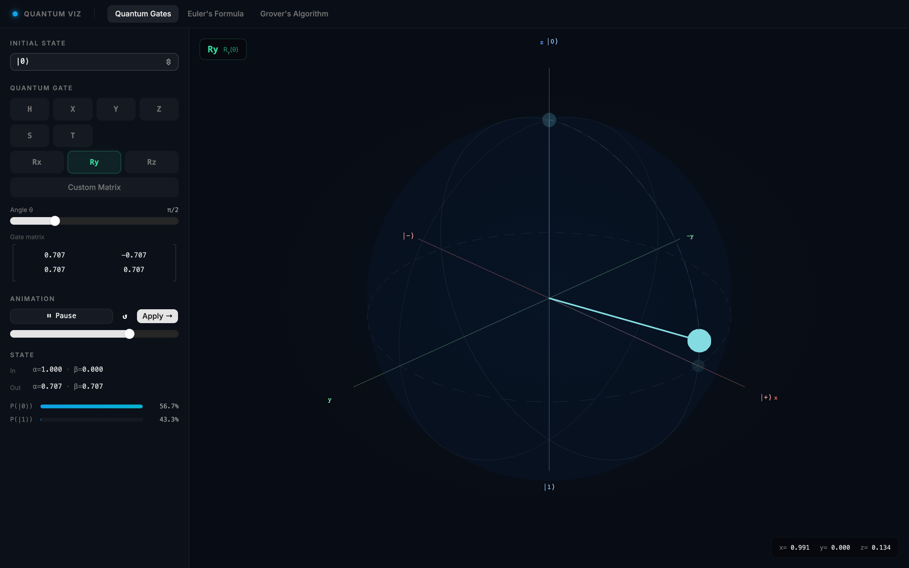
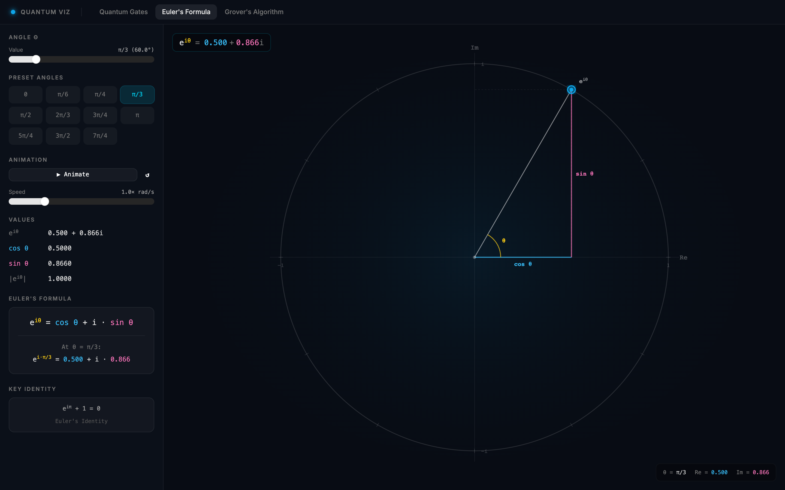
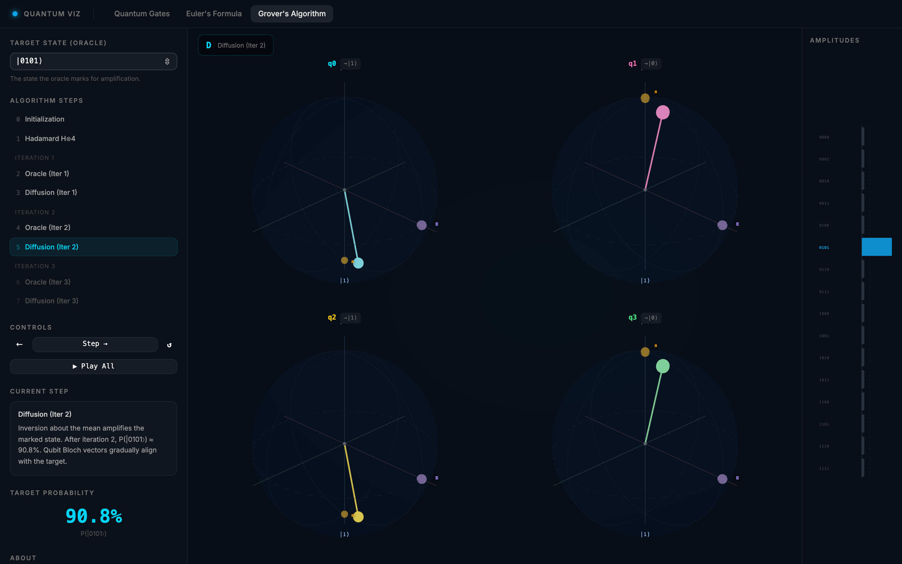

# Quantum Computing Visualizations

Interactive, browser-based visualizations for learning the basics of quantum computing. Apply gates to a qubit on a 3D Bloch sphere, see how Euler's formula traces the unit circle in the complex plane, and step through Grover's search algorithm one oracle and diffusion step at a time.

Built with React, TypeScript, Vite, React Three Fiber and shadcn/ui.

**Live demo:** https://quantum-computing-visualizations.leodriesch.workers.dev

## Visualizations

### Quantum Gates



Single-qubit gate operations on an interactive 3D Bloch sphere.

- Start from a basis state (`|0⟩`, `|1⟩`, `|+⟩`, `|−⟩`, `|i⟩`, `|−i⟩`) or set a custom state with the polar angle θ and azimuthal angle φ.
- Apply the fixed gates H, X, Y, Z, S and T, the rotation gates Rx(θ), Ry(θ) and Rz(θ) with an adjustable angle, or enter your own 2×2 complex matrix (a warning appears if it is not unitary).
- Play or scrub the animation to see the path the state vector takes, then apply the gate to chain several operations.
- The side panel shows the gate matrix, the input and output amplitudes α and β, and the measurement probabilities P(|0⟩) and P(|1⟩).

### Euler's Formula



A 2D unit circle in the complex plane showing e<sup>iθ</sup> = cos θ + i sin θ.

- Drag the angle slider, pick a preset angle from 0 to 7π/4, or animate θ at an adjustable speed.
- The real part (cos θ) and imaginary part (sin θ) are drawn as the legs of a right triangle and listed numerically.
- Includes Euler's identity, e<sup>iπ</sup> + 1 = 0. The complex phase e<sup>iφ</sup> is what the azimuthal angle on the Bloch sphere represents.

### Grover's Algorithm



A step-by-step animation of Grover's search on 4 qubits (16 basis states).

- Choose which state the oracle marks, then step forward and back or play all steps: initialization, Hadamard on every qubit, and three oracle + diffusion iterations.
- Each qubit has its own Bloch sphere showing its reduced state. Vectors shorter than the sphere's radius mean the qubit is entangled with the others.
- The amplitude chart shows the oracle flipping the sign of the marked state and the diffusion step increasing its amplitude, until the target reaches about 96% probability after three iterations.

## Development

```bash
npm install && npm run dev
```

Deploy to Cloudflare Workers with `npm run deploy`.
